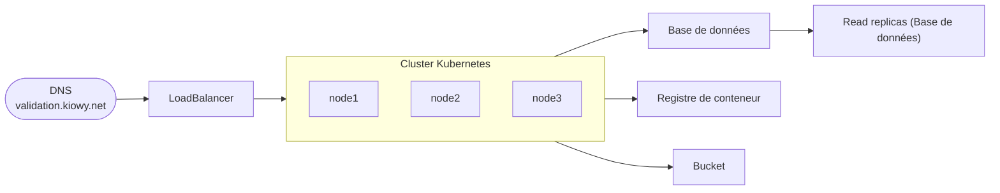

> [!warning]
> Outdated

[](https://u-bourgogne.fr/) | Polytech Dijon - 4A - ILIA/SQR <br/> Validation <br/><br/> **[ EXAMEN PRATIQUE ]** | [](https://esirem.u-bourgogne.fr/)
:--- | :---: | ---:
|| À rendre au plus tard le `27 Mars 2026 à 23h59` ||

Sommaire
---

* [Sujet du projet](#sujet-du-projet)
* [Exigences projet](#exigences-pour-le-projet)

---

Ce projet noté de validation du module de Cloud computing évaluera compétences et bonnes pratiques de développement vues en cours. La notation tiendra compte des fonctionnalités déployées dans l’API, de la bonne mise en place des points d’exigences projets, de votre compréhension de votre code ainsi que de la collaboration entre les membres du groupe.

---

# Sujet du projet

Créer des resources à partir de fichier HCL et YAML

---

## Terraform

[](https://developer.hashicorp.com/terraform/docs)
[](https://registry.terraform.io/providers/scaleway/scaleway/latest/docs)

Qui dit "projet" dit aussi "contraintes supplémentaires" ! Nous voulons une calculatrice qui soit hébergée en France **et** par un fournisseur français. 🐓

```hcl
terraform {
  required_providers {
    scaleway = {
      source = "scaleway/scaleway"
    }
  }
  required_version = ">= 0.13"
}
```

En utilisant le provider Terraform de [Scaleway](https://registry.terraform.io/providers/scaleway/scaleway/latest/docs), fournisseur de Cloud français, décrivez l'infrastructure as code:

* Un **registre** de conteneur.
* Un cluster **Kubernetes** de trois noeuds.
* Une base de données.
* Un bucket.
* Une **entrée DNS** pour `validation.kiowy.net` pour résoudre l'IP d'un des **LoadBalancers**.
* Un **LoadBalancer**.

> Stocker les fichiers dans le dossier `foundation`



**Vous devez utiliser des variables** pour nommer les ressources dédiées à un environment selon les environments.

> [!TIP]
> Ce qui veut dire que les fichiers ne contiendrons qu'une instance de chaque type de ressource
> (une pour le registre, une pour le cluster, une pour **les** bases de données, une pour **les** entrées DNS et une pour **les** LoadBalancers, etc).

Cette section est terminée si les commandes `terraform fmt`, `terraform validate` et `terraform plan` s'exécutent sans erreur.

> [!important]
> Le résultat du `terraform plan` est à ajouter au README.md de ce même dossier.

> [!caution]
> L'API Terraform de Scaleway ne nécéssite pas d'authentification pour réaliser les commandes `terraform fmt`, `terraform validate` et `terraform plan`. Vous pouvez donc réaliser des commandes sans être connecté. **Vous n'avez pas besoin de vous créer un compte chez Scaleway pour réaliser cette section.**

> [!NOTE]
> [Documentation Terraform](https://developer.hashicorp.com/terraform/docs) **-** [Documentation Scaleway Terraform](https://registry.terraform.io/providers/scaleway/scaleway/latest/docs) **-** [Documentation Scaleway](https://www.scaleway.com/en/docs/)

## Kubernetes

> [!warning]
> Le cluster Kubernetes n'est plus disponible, vous vous contenterez de décrire les manisfests Kubernetes à partir de la documentation disponible sur [kubernetes.io](kubernetes.io/docs/)

Voici une petite liste de course des instances de ressource K8S que vous devez déployer **as code** dans votre namespace:
* 1 ConfigMap `<PRENOM>-cm` contenant la variable `OWNER_NAME=<PRENOM>`.
* 1 Service TCP qui expose `what-an-url:8080` au sein du cluster pour les pods du déploiement `validation`.
* 1 Deploiement nommé `<prenom>-validation` de 2 replicas d'un Pod que qualité de service `Guaranteed` avec:
  *  un conteneur executant l'image:
  ```sh
  nginx:latest
  ```
  *  `100m` de puissance de calcul et `128Mi` de mémoire.
  *  un label `app-of=<PRENOM>`.
  *  une variable environnement `OWNER_NAME` extraite depuis la configmap `<PRENOM>-cm`.

> [!NOTE]
> Documentations pour la section:
> [Kubernetes](https://kubernetes.io/docs/home/)
> **-** [K8S Pod](https://kubernetes.io/docs/concepts/workloads/pods/)
> **-**  [K8S Service](https://kubernetes.io/fr/docs/concepts/services-networking/service/)
> **-**  [K8S ReplicaSet](https://kubernetes.io/docs/concepts/workloads/controllers/replicaset/)
> **-**  [K8S Deployment](https://kubernetes.io/docs/concepts/workloads/controllers/deployment/)
> **-**  [K8S Namespace](https://kubernetes.io/docs/concepts/overview/working-with-objects/namespaces/)

---

## Exigences pour le projet

Ce projet à rendre au plus tard le `27 mars 2026 à 23h59`.

> [!WARNING]
> À partir de cette date, aucune modification du dépôt ou de code ne sera prise en compte.
